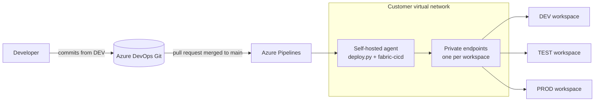

# Secure CI/CD for Microsoft Fabric with workspace-level private links

Reference implementation for deploying Microsoft Fabric items from Azure DevOps when your workspaces only accept traffic through workspace-level private links.

Git stays the source of truth. A self-hosted Azure DevOps agent inside your virtual network runs [fabric-cicd](https://microsoft.github.io/fabric-cicd/) and reaches each workspace through its own private endpoint.

> Companion code for the Microsoft Fabric Community blog post *Secure Fabric CI/CD with Workspace-Level Private Link*. Blog link: to be added after publication.

## Architecture

## What's in this repository

| Path | Purpose |
| --- | --- |
| `deploy.py` | Signs in with a service principal, targets the workspace-specific endpoint and publishes items with fabric-cicd |
| `azure-pipelines.yml` | One deployment stage per environment (dev, test, prod) on your self-hosted agent pool |
| `requirements.txt` | Python packages: `azure-identity` and `fabric-cicd` |
| `workspace/` | Your Fabric item definitions, committed with Fabric Git integration |
| `docs/setup-guide.md` | Full setup, pipeline variables, validation steps and troubleshooting |

## Quick start

1. Create DEV, TEST and PROD workspaces on a Fabric F SKU capacity and add your deployment service principal to each one.
2. Create a workspace-level private link service and a private endpoint for each workspace, then link private DNS to the agent's virtual network.
3. Deploy a self-hosted Azure DevOps agent in that virtual network with Python 3.9 to 3.14.
4. Create the variable groups `fabric-dev`, `fabric-test` and `fabric-prod`, plus Azure DevOps environments with the same names. Add approvals to test and prod.
5. Replace `<self-hosted-agent-pool>` in `azure-pipelines.yml`, commit your Fabric items under `workspace/`, then run the pipeline.

See [docs/setup-guide.md](docs/setup-guide.md) for the full walkthrough.

## Before you use it

- `deploy.py` imports `configure_fabric_fqdn` from fabric-cicd to target the workspace-specific endpoint before it creates the `FabricWorkspace` client. Confirm that your installed fabric-cicd version provides it, because function names can change between releases.
- Never commit secrets, tenant IDs, workspace IDs or endpoint hostnames. Keep them in Azure Key Vault and pipeline variable groups.
- This is a reference implementation, not a product support statement. Check the latest Microsoft Learn documentation and supported scenarios before you use it in production.

## Learn more

- [Set up and use workspace-level private links](https://learn.microsoft.com/en-us/fabric/security/security-workspace-level-private-links-set-up)
- [Workspace-level private links overview](https://learn.microsoft.com/en-us/fabric/security/security-workspace-level-private-links-overview)
- [Supported scenarios and limitations for workspace-level private links](https://learn.microsoft.com/en-us/fabric/security/security-workspace-level-private-links-support)
- [CI/CD for Microsoft Fabric using Azure DevOps and fabric-cicd](https://learn.microsoft.com/en-us/fabric/cicd/tutorial-fabric-cicd-azure-devops)
- [fabric-cicd documentation](https://microsoft.github.io/fabric-cicd/)
